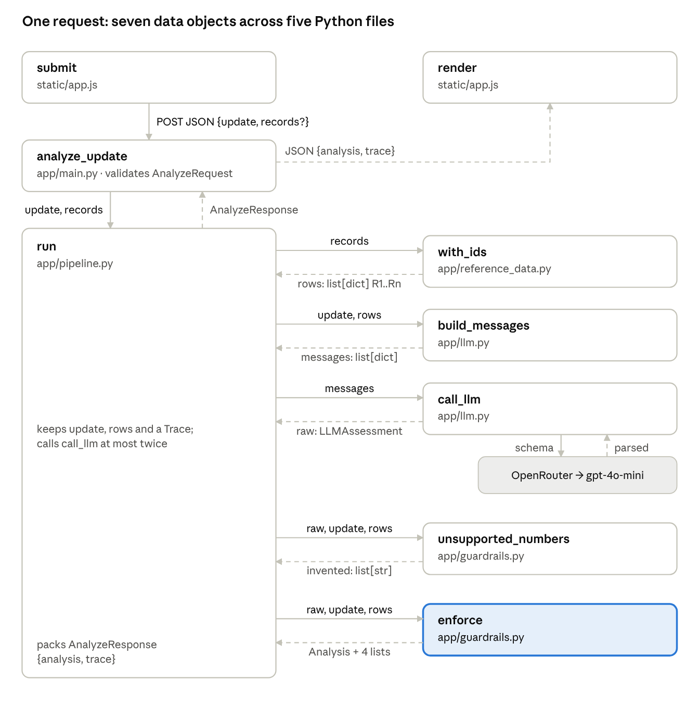
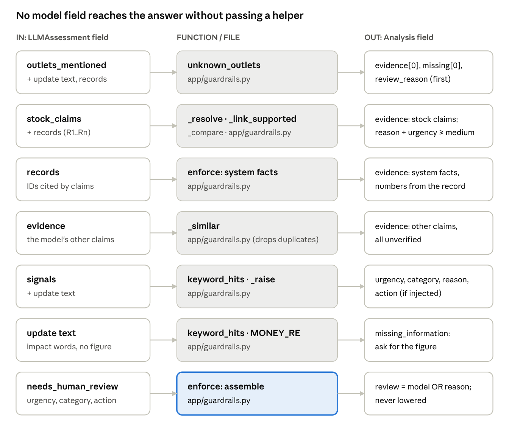
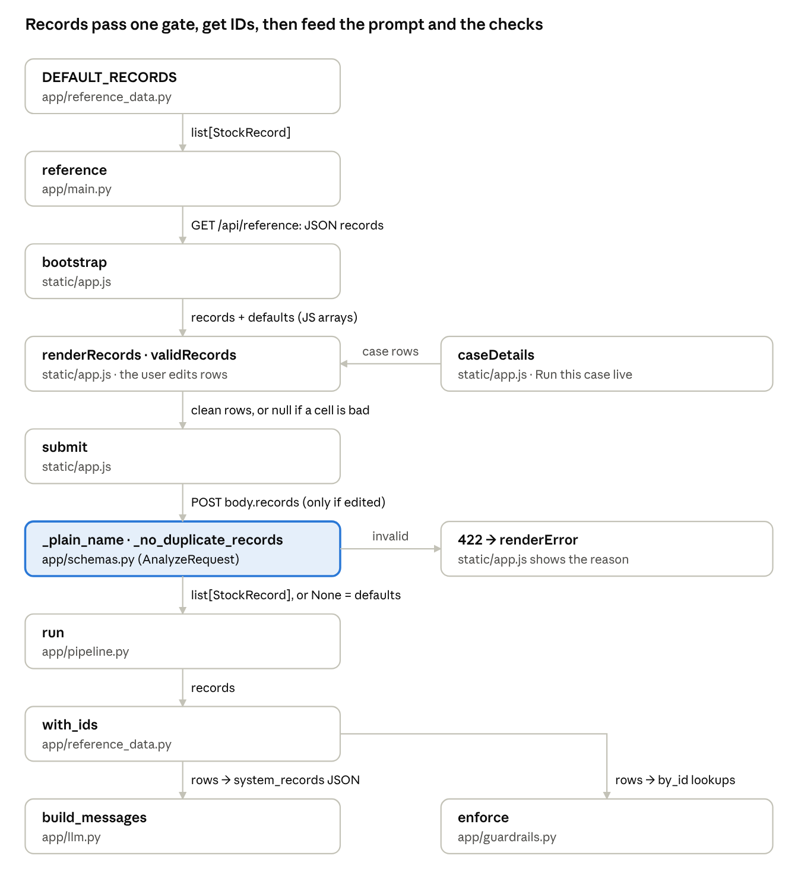
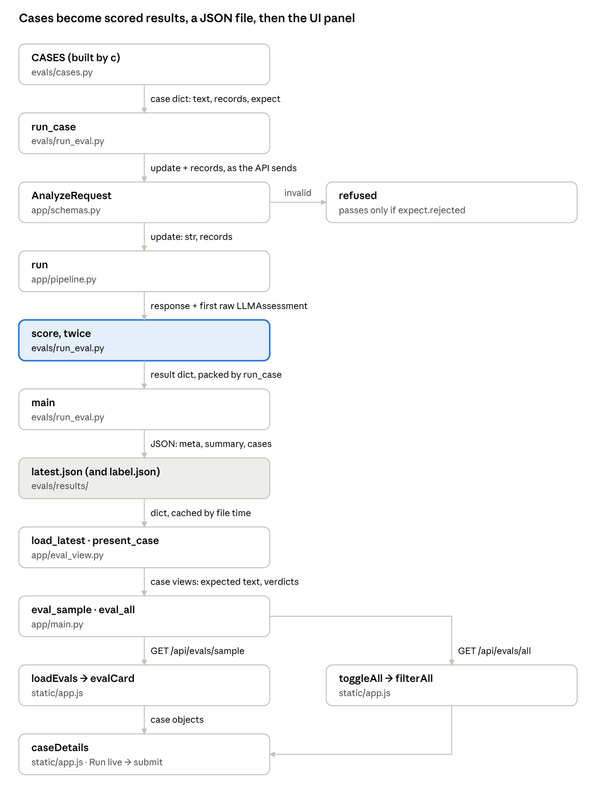

# SalesEasy — Data Flow by Function and File

_As of 2026-10-18 · companion: [FUNCTION_REFERENCE.md](FUNCTION_REFERENCE.md)_

## How to read the diagrams

Each diagram follows one piece of data from where it is created to where it is used. A field update becomes 7 objects on its way through 5 Python files and back to the browser.

- **Box** = a function, written as `function` with its file underneath, e.g. **call_llm** / *app/llm.py*.
- **Arrow label** = the data passed along that arrow, with its type, e.g. `messages: list[dict]`.
- **Accent box** = where the decision in that diagram is made.
- **Order**: diagrams run top to bottom; a return value comes back up only when it is drawn as a dashed arrow.

The companion [FUNCTION_REFERENCE.md](FUNCTION_REFERENCE.md) explains what each function does; this doc shows only what moves between them.

## Main path: one analyze request

The update text and the records travel together from `submit` to `run`; `run` sends them out to four helpers and gets a new object back from each, ending with `enforce`'s `Analysis`.

If `unsupported_numbers` returns a non-empty list, `run` appends the model's answer and the violation to `messages` and sends them back to `call_llm` once more. A rejected request never reaches `run`: FastAPI returns 422 from `analyze_update` and `render` is replaced by `renderError` in *static/app.js*.

## Inside enforce: model fields to answer fields

`enforce` in *app/guardrails.py* receives `raw: LLMAssessment` from *app/pipeline.py*; each model field reaches the final `Analysis` only through a helper, and the model's own urgency, category and review flag survive only as a floor that code can raise.

Lanes follow the order the code runs, with one exception: system facts (lane 3) are written after lane 4 but placed first among the evidence lines. Lane 1 runs before the others, which is why an unknown outlet is always the first reason. Before lane 2, claims the model filed under `evidence` that describe a stock level (and no impact) are moved into `stock_claims`; anything in lane 4 that still duplicates a stock claim is dropped. The 4 lists returned beside the `Analysis` (stock checks, rules fired, notes, reasons) go into `Trace` in *app/pipeline.py*.

## Records: from defaults or the browser to the checks

Records enter from two places, the defaults in *app/reference_data.py* or rows edited in the browser, and browser rows pass the validation gate in *app/schemas.py* before `with_ids` numbers them R1..Rn.

The defaults are built as `StockRecord` objects, so the same name check runs on them at import. The browser sends `records` only when the table differs from the defaults, so an unedited request uses `DEFAULT_RECORDS` again inside `run` and the trace says `records_source: default`. The same numbered `rows` feed both the prompt (`build_messages`) and the comparisons in `enforce`, so the model and the code always refer to the same R-numbers.

## Evaluation: cases to results to the UI

Evaluation data makes one round trip: 104 case dicts in *evals/cases.py* run through the real `run` in *app/pipeline.py*, are saved as one JSON file, and come back to the browser through *app/eval_view.py*.

`score` runs twice per case on the same response: once on the final `Analysis`, once on the model's first raw answer, which is how the "model alone" column is produced. `run_case` packs both into one result dict; `main` adds the summary and metadata (model, prompt and schema hashes). The UI never calls the model for these numbers; it only reads the saved file, except when you press "Run this case live", which sends the case to `submit` and the main path above.

## Data objects

Fifteen objects carry all the data in the diagrams above; each row says where it is defined, which function / file creates it and which reads it.

| Object | Type | Defined in | Produced by | Consumed by |
| --- | --- | --- | --- | --- |
| request body | JSON `{update, records?}` | — | `submit` / static/app.js | `analyze_update` / app/main.py |
| `AnalyzeRequest` | Pydantic model | app/schemas.py | FastAPI, for `analyze_update` / app/main.py; `run_case` / evals/run_eval.py | `run` / app/pipeline.py |
| records | `list[StockRecord]` | app/schemas.py | `AnalyzeRequest`, or `DEFAULT_RECORDS` / app/reference_data.py | `with_ids` / app/reference_data.py |
| `rows` | `list[dict]` with `record_id` R1..Rn | — | `with_ids` / app/reference_data.py | `build_messages` / app/llm.py; `unsupported_numbers`, `enforce` / app/guardrails.py |
| `messages` | `list[dict]` (system + user) | — | `build_messages` / app/llm.py; extended by `run` on a retry | `call_llm` / app/llm.py |
| `raw` | `LLMAssessment` | app/schemas.py | `call_llm` / app/llm.py | `unsupported_numbers`, `enforce` / app/guardrails.py; `run_case` / evals/run_eval.py |
| `StockClaim`, `Signals` | parts of `LLMAssessment` | app/schemas.py | the model, via `call_llm` | `enforce` / app/guardrails.py |
| `invented` | `list[str]` | — | `unsupported_numbers` / app/guardrails.py | `run` / app/pipeline.py (retry or not) |
| `Analysis` | Pydantic model (7 fields) | app/schemas.py | `enforce` / app/guardrails.py, or `fallback_analysis` / app/pipeline.py | `AnalyzeResponse`; `score` / evals/run_eval.py |
| `StockCheck` | Pydantic model | app/schemas.py | `enforce` / app/guardrails.py | `Trace.stock_checks` |
| `Trace` | Pydantic model | app/schemas.py | `run` / app/pipeline.py | `render` / static/app.js (trace panel, numbered reasons) |
| `AnalyzeResponse` | Pydantic model `{analysis, trace}` | app/schemas.py | `run` / app/pipeline.py | `analyze_update` / app/main.py → `render` / static/app.js; `run_case` / evals/run_eval.py |
| case dict | `dict` (id, family, text, records, expect) | evals/cases.py | `c` / evals/cases.py | `run_case`, `score`, `records_for` / evals/run_eval.py |
| results file | JSON (meta, summary, cases) | evals/results/ | `main` / evals/run_eval.py | `load_latest` / app/eval_view.py |
| case view | `dict` (expected text, verdicts, records) | — | `present_case` / app/eval_view.py | `evalCard`, `caseDetails`, `filterAll` / static/app.js |
