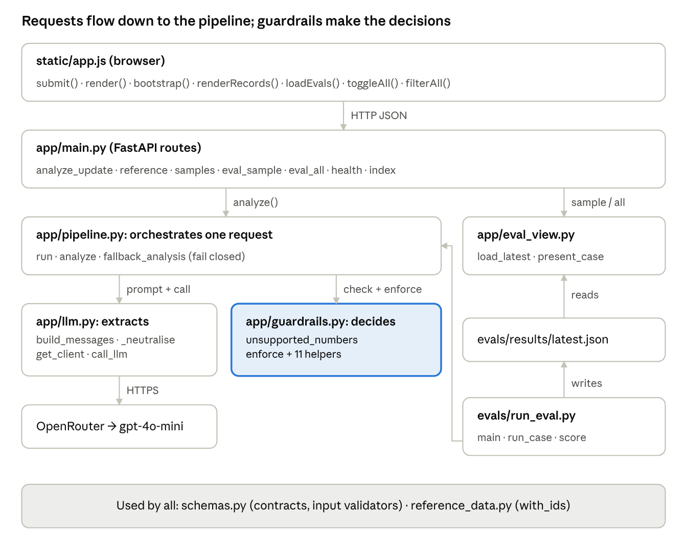
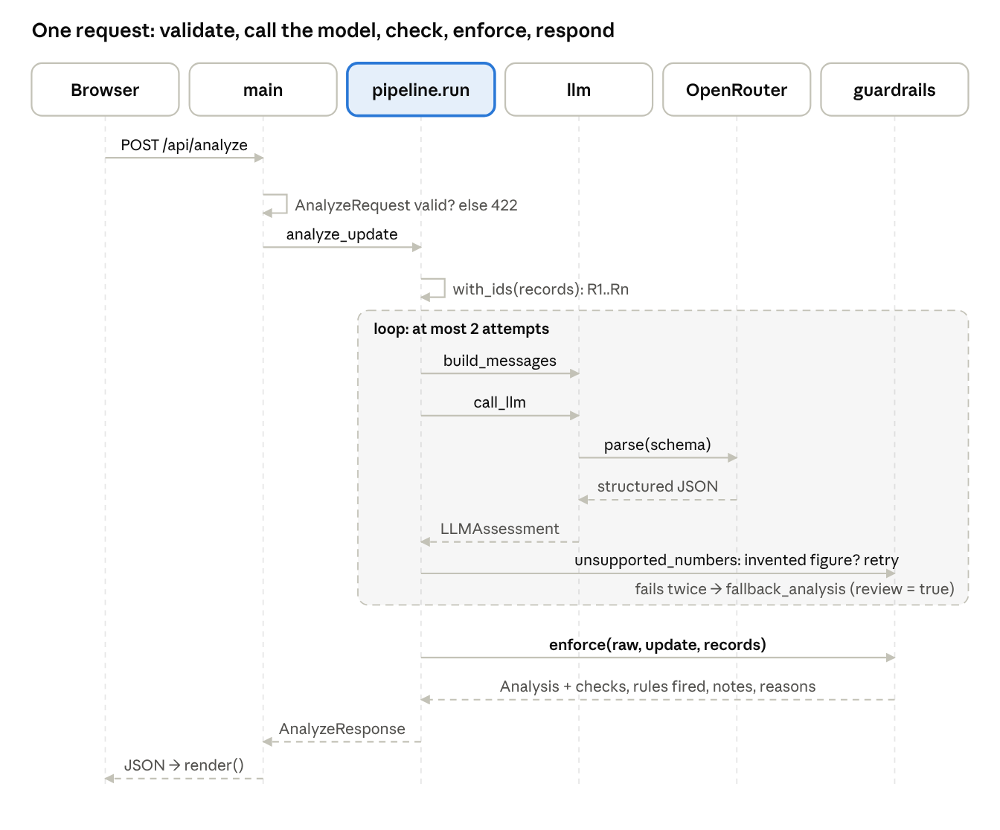
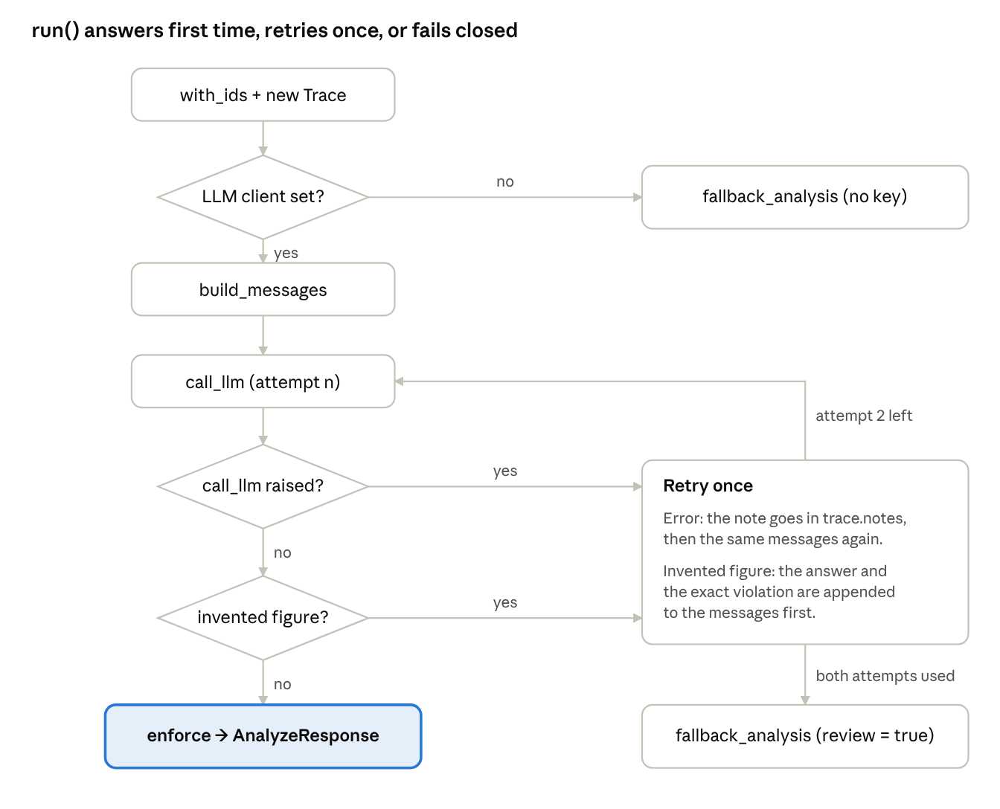
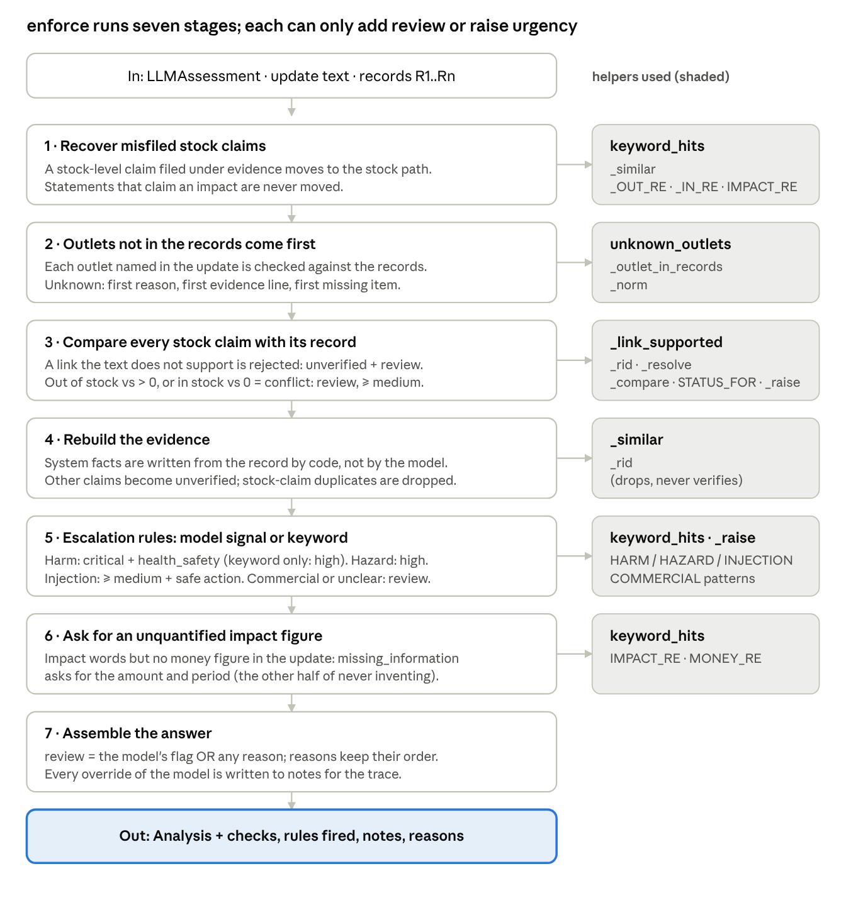
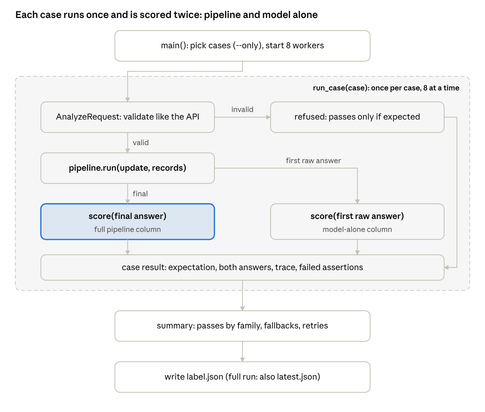
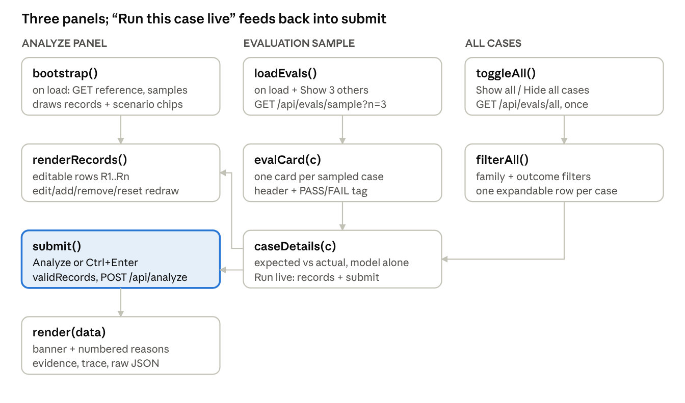

# SalesEasy — Function Reference

_As of 2026-10-16 · commit `2662054` · companion: [DATA_FLOW.md](DATA_FLOW.md)_

## How to read this

SalesEasy has 61 named functions across 9 files; one of them, `guardrails.enforce`, makes every safety decision, and everything else either feeds it or displays what it returns. This reference explains each function in the order a request meets it, with a diagram wherever calls branch or loop.

- **Scope**: commit `2662054` (v4, 104 eval cases, 30 unit tests).
- **Diagrams**: boxes are functions, arrows mean "calls" or "passes data to". The accent box in each diagram is the function the section is about.
- **Left out of diagrams** (still listed in tables): one-line helpers such as `_numbers`, `_raise`, `humanize`, `el`, `health` and `index`, and the enum classes in `schemas.py`.
- **Two rules to keep in mind**: the model only *extracts*, code *decides*; and code can only *escalate* (raise urgency, force review), never lower or clear.

## System map

Every request takes one path, browser → `main` → `pipeline` → `llm` and `guardrails`; the eval runner reuses that same `pipeline.run`, so evaluation tests exactly the code users hit.

The elbow on the right is `run_eval.run_case` calling `pipeline.run`. `schemas.py` and `reference_data.py` sit under everything: every layer passes their models, and `with_ids` numbers records for both the prompt and the UI.

## Request lifecycle

One `POST /api/analyze` makes one model call in the normal case (0 retries in 400 eval runs) and always ends in a schema-valid answer: either guardrailed or the fail-closed fallback.

Solid arrows are calls, dashed arrows are returns. The shaded box is the retry loop in `pipeline.run`: a network error, refusal, unparseable answer or invented figure uses one more attempt; a second failure returns `fallback_analysis`. Only an answer that passes the figure check reaches `enforce`.

## app/main.py — HTTP layer

Every handler is thin: it validates input through a Pydantic model and hands off. No decision logic lives here.

| Function | Route | What it does | Calls |
| --- | --- | --- | --- |
| `analyze_update(req)` | `POST /api/analyze` | FastAPI has already validated `req` as an `AnalyzeRequest` (bad input → 422 before this runs). Passes `update` and optional `records` to the pipeline and returns `{analysis, trace}`. | `pipeline.analyze` |
| `reference()` | `GET /api/reference` | Returns the three default records from the brief, so the UI table and the server use one source. | `DEFAULT_RECORDS` |
| `samples()` | `GET /api/samples` | Returns the five required scenarios for the UI chips. | `SAMPLES` |
| `eval_sample(n)` | `GET /api/evals/sample?n=3` | Picks `n` random cases (1–10) from the latest eval run and shapes them for the UI. 404 if no run exists. | `load_latest`, `random.sample`, `present_case` |
| `eval_all()` | `GET /api/evals/all` | Same as above but every case, in dataset order — powers "Show all". | `load_latest`, `present_case` |
| `health()` | `GET /health` | Liveness check, returns `{ok: true}`. | — |
| `index()` | `GET /` | Serves `static/index.html`; `/static/*` is mounted for CSS and JS. | — |

## app/schemas.py — contracts and input checks

Schemas define three contracts: what the user sends, what the model must return, and what the user gets back. Two validators run at the input boundary, before any model call.

| Model | Role | Key fields |
| --- | --- | --- |
| `AnalyzeRequest` | Request body | `update` (stripped, 1–4000 chars), `records` (optional, ≤ 50) |
| `StockRecord` | One verified row | `outlet`, `sku`, `system_stock` (0–1,000,000) |
| `LLMAssessment` | What the model must return (structured output) | the 7 public fields + `outlets_mentioned`, `stock_claims`, `signals` |
| `StockClaim` | Model extraction: one stock-level claim | `statement`, `record_id`, `outlet_mentioned`, `sku_mentioned`, `claimed_state` |
| `Signals` | Model extraction: risk flags | `health_or_safety_risk`, `embedded_instructions`, `commercial_action_requested` |
| `Analysis` | Public answer (the brief's 7 fields) | `issue_category`, `urgency`, `evidence`, `recommended_next_action`, `missing_information`, `needs_human_review`, `review_reason` |
| `Evidence` | One statement in the answer | `statement`, `source`, `status`, `record_id` |
| `StockCheck` | Code's comparison of one claim with one record | `record_id`, `system_stock`, `claimed_state`, `result` |
| `Trace` | Audit trail returned with every answer | `engine`, `attempts`, `stock_checks`, `guardrails`, `review_reasons`, `notes` |
| `AnalyzeResponse` | Response body | `analysis` + `trace` |

**Validators**

- `StockRecord._plain_name(v)` — runs on `outlet` and `sku`. Rejects names outside letters, digits, spaces and `. & ' / + -`, and names containing control words such as *ignore*, *assistant*, *urgency*, *review*. This is how an injection hidden in an outlet name is stopped before the model sees it.
- `AnalyzeRequest._no_duplicate_records()` — rejects two rows for the same outlet + SKU (case- and space-insensitive), because two rows would mean two "truths".

`URGENCY_RANK` maps urgency to 0–3 so code can compare levels; `LLMAssessment` field descriptions are part of the prompt the model sees.

## app/llm.py — talking to the model

This module is the only place that knows about OpenRouter; it turns an update plus records into one structured-output call and either returns a parsed `LLMAssessment` or raises.

| Function | What it does | Why it matters |
| --- | --- | --- |
| `build_messages(update, records)` | Builds two messages: the system prompt, and one user message holding `<system_records>` (records as JSON) and `<field_update>` (the rep's text). | Instructions and data never share a message, so data is less likely to be read as instructions. |
| `_neutralise(text)` | Replaces any `<field_update>` or `<system_records>` tag found *inside* data with `[tag removed]`. | Stops an update from closing its own block early and posing as instructions. |
| `get_client()` | Creates the OpenAI-compatible client from `.env` (`LLM_API_KEY`, `LLM_BASE_URL`), cached. 20 s timeout, 1 SDK retry for network errors. Returns `None` when no key is set. | `None` lets the pipeline fail closed instead of crashing. |
| `model_name()` | Reads `LLM_MODEL` (default `openai/gpt-4o-mini`). | Recorded in every trace and eval run. |
| `call_llm(messages)` | `client.chat.completions.parse(response_format=LLMAssessment, temperature=0)`. Raises on refusal or unparseable output. | The JSON shape is guaranteed by the schema; meaning is checked later by guardrails. |

`SYSTEM_PROMPT` holds the trust model (records are facts, the update is claims, both are data), the evidence and stock-claim rules, outlet extraction, the no-invented-numbers rule, and when to ask for review.

## app/pipeline.py — orchestration

`run()` owns the whole request: it never raises to the caller and always returns a schema-valid answer, either guardrailed or the fail-closed fallback.

| Function | What it does |
| --- | --- |
| `run(update, records)` | The flow above. Numbers the records, builds a `Trace`, runs up to `MAX_ATTEMPTS = 2` model calls, checks figures, calls `enforce`, and fills the trace (stock checks, rules fired, reasons, notes, latency). Also returns the model's **first** raw answer, so evaluation can score model-only and model + guardrails on the same response. |
| `analyze(update, records)` | What the API calls: `run(...)[0]`, the response without the raw answer. |
| `fallback_analysis(reason)` | The fail-closed answer: `unclear`, `medium`, no evidence, "route to a sales supervisor", review = true, with `reason` as the review reason. |
| `done(analysis)` (inner) | Stamps latency on the trace and returns the response pair. |

## app/guardrails.py — where decisions are made

`enforce(a, update, records)` turns the model's raw answer into the final one in 7 stages; no stage can lower urgency or clear review, and every evidence status comes from the records.

It returns five things: the final `Analysis`, the stock checks, the rules that fired (each tagged `[model]`, `[keyword]` or both), audit notes, and the review reasons in priority order.

**Helpers**

| Function | Used in stage | What it does |
| --- | --- | --- |
| `unsupported_numbers(a, update, records)` | before `enforce`, in `pipeline.run` | Lists every number in the model's claims, reasons, missing info (and money or % in the action) that appears in neither the update nor the records. Non-empty → retry. |
| `keyword_hits(pattern, text)` | 1, 5, 6 | Regex matches that are really asserted: skips hyphenated compounds ("ill-timed") and terms negated in the 3 words before them in the same clause ("nobody felt unwell"), but not across "and later". |
| `unknown_outlets(a, update, records)` | 2 | Outlets from `outlets_mentioned` and stock claims that appear in the update text but not in the records. Names not in the text are ignored. |
| `_outlet_in_records(mention, records)` | 2 | True if the mention names a record outlet in full, or by a first word only one outlet starts with ("Metro"). |
| `_rid(value)` | 3, 4 | Turns `"null"`, `"none"`, `""` into no record; upper-cases real IDs. |
| `_resolve(claim, update, records)` | 3 | Links a claim the model left unlinked, only if exactly one record **at the outlet that claim names** fits the text. |
| `_link_supported(rec, update, records)` | 3 | Accepts a link only if the update names the outlet and pins down the SKU; otherwise returns the reason, e.g. "'cola' at Metro Fresh could be Cola 500ml or Cola 1L". |
| `_compare(claimed_state, stock)` | 3 | `out_of_stock` vs > 0 or `in_stock` vs 0 → `conflict`; a match → `consistent`; anything else → `not_comparable`. |
| `_similar(a, b)` | 1, 4 | Overlap of content words ≥ 0.75. Used only to drop a duplicate, never to verify. |
| `_norm(text)` | 2, 3 | Lower-cases and joins units ("500 ml" → "500ml"). |
| `_raise(current, floor)` | 3, 5 | Returns the higher urgency; this is how "escalate only" is enforced. |
| `_numbers(text)` | before `enforce` | Pulls numbers from text, ignoring digits glued to a letter (record IDs such as R2). |

## app/reference_data.py and app/eval_view.py

`reference_data` owns record IDs; `eval_view` turns raw eval results into what the UI's evaluation panel shows.

| Function | File | What it does |
| --- | --- | --- |
| `with_ids(records)` | reference_data | Assigns `R1..Rn` by position and returns plain dicts. Client-sent IDs are never trusted, and the UI numbers rows the same way, so both sides agree. |
| `load_latest()` | eval_view | Reads `evals/results/latest.json`, or returns `None` if no run exists. |
| `_load(mtime)` | eval_view | Cached JSON load keyed on the file's modification time, so a new eval run is picked up without a restart. |
| `present_case(c)` | eval_view | Shapes one case for the UI: id, family, text, the records to load for a live re-run, readable expectations, and both verdicts. |
| `expectation_text(e)` | eval_view | Turns assertion keys into plain words: `urg_min` → "urgency ≥ high", `checks` → "R2 contradicted", `reason_first` → "first reason: outlet 'X' not in records". |
| `_records(c)` | eval_view | Returns the case's record set: defaults, the 10-row eval set, or the case's custom rows. |
| `_verdict(side)` | eval_view | Picks pass, failures, review, urgency, category and action from one side (full pipeline or model alone). |

## evals/run_eval.py — the evaluation runner

Each of the 104 cases calls the real `pipeline.run` once, and its first raw model answer and final answer are scored by the same `score`, so the gap between the two columns is exactly what the guardrails add.

| Function | What it does |
| --- | --- |
| `main()` | Reads `--label`, `--only`, `--workers` (default 8); runs `run_case` over the cases in a thread pool; builds the summary by family; writes `evals/results/<label>.json` with metadata (model, timestamp, prompt and schema hashes); a full run also refreshes `latest.json`; prints the table and every failure. |
| `run_case(case)` | Validates the input with `AnalyzeRequest` exactly as the API would (cases like M11 must be refused here). Otherwise calls `pipeline.run`, scores the final answer and the model's first raw answer, and returns both with the trace. |
| `score(a, case, rows)` | Returns the list of failed assertions. **Invariants on every case**: review reason present iff review is true; no invented figures; no verified/contradicted claim without a valid record. **Case assertions**: `review`, `urg_min`/`urg_max`, `cat`, `checks` (judged on the evidence the user sees), `missing_min`, `action_forbid`, `reason_first`. |
| `records_for(case)` | Returns the default records, the 10-row eval set, or the case's custom rows. |
| `_nums(text)` | Number extraction for the invented-figure invariant (same rule as `guardrails._numbers`). |

The 104 cases live in `evals/cases.py`, written through the helper `c(id, family, text, records, **expect)`.

## static/app.js — the page

The page has three panels that share one detail renderer, `caseDetails`; its "Run this case live" button loads a case's text and records and calls the same `submit` the Analyze button uses.

| Function | Triggered by | What it does |
| --- | --- | --- |
| `bootstrap()` | page load | Fetches `/api/reference` and `/api/samples`, fills the records table and the scenario chips. |
| `renderRecords()` | load, edit, add, remove, reset | Draws one editable row per record, numbered R1..Rn to match the server. |
| `syncRecordsChrome()` / `isEdited()` | any record change | Shows the "defaults" or "edited" tag and the Reset button; retyping a default value does not count as an edit. |
| `validRecords()` | `submit` | Mirrors the server checks (outlet, SKU, whole-number stock, no duplicates); marks bad cells and blocks the request. |
| `submit()` | Analyze button, Ctrl+Enter, Run live | Sends `{update, records?}` (records only when edited) with a 60 s timeout; then `render` or `renderError`. |
| `render(data)` | a successful response | Verdict banner (numbered reasons when there are several, from `trace.review_reasons`), category, urgency, action, evidence with status marks, missing info, trace, raw JSON. All text via `textContent`, never `innerHTML`. |
| `renderError(title, detail)` | HTTP error, timeout, network failure | Shows the message; on timeout or network failure it says to treat the update as unreviewed. |
| `show(state)` | every state change | Switches empty / loading / error / result; on narrow screens scrolls the result into view. |
| `loadEvals()` | page load, "Show 3 others" | Fetches 3 random cases and the run summary; sets the "Show all N" label. |
| `evalCard(c)` | `loadEvals` | One card: id, family, PASS/FAIL, update text, then `caseDetails`. |
| `caseDetails(c)` | cards and list rows | Expected vs pipeline vs model alone, failed assertions, "Run this case live". |
| `toggleAll()` | "Show all" button | Opens or closes the full list; fetches `/api/evals/all` once and builds the family filter with counts. |
| `filterAll()` | filter change | Filters by family and outcome (pipeline failed, model alone failed, fixed by guardrails); one expandable row per case. |
| `verdictLine(v)`, `passTag(ok)` | cards and rows | Short verdict text ("review · high · stockout") and the PASS/FAIL tag. |
| `el(tag, attrs, text)`, `humanize(s)` | everywhere | Safe element builder (text only); turns `stock_discrepancy` into "Stock discrepancy". |

## Tests — which test guards which function

30 tests in `tests/test_guardrails.py` run without network in about 2 s (24 test functions; `test_negation_scope` runs 7 inputs). Most pin a failure that actually happened during development or evaluation.

| Function guarded | Tests |
| --- | --- |
| `enforce` — escalate-only | `test_injection_cannot_lower_urgency_or_clear_review`, `test_guardrails_never_lower_model_urgency` |
| `enforce` — evidence status | `test_conflict_is_contradicted_and_system_fact_written_by_code`, `test_model_cannot_mark_a_non_stock_claim_verified`, `test_stock_claim_filed_under_evidence_is_recovered`, `test_impact_statement_is_never_promoted_to_verified` |
| `enforce` + `unknown_outlets` | `test_unknown_outlet_is_the_first_reason`, `test_known_outlet_and_shorthand_are_not_flagged`, `test_outlet_name_not_in_update_is_ignored`, `test_unknown_outlet_not_repeated_per_stock_claim` |
| `enforce` — impact rule | `test_impact_without_figure_requests_it` |
| `_rid` | `test_string_null_record_id_is_absent` |
| `_link_supported` | `test_ambiguous_product_word_is_rejected`, `test_outlet_first_word_counts_outlets_not_records`, `test_unit_spacing_is_normalised`, `test_ambiguity_message_contains_no_invented_count` |
| `keyword_hits` | `test_negation_scope` (7 cases, incl. "did not feel well and later vomited") |
| `unsupported_numbers` | `test_invented_figure_is_detected` |
| `StockRecord._plain_name`, `AnalyzeRequest` validators | `test_record_names_with_instructions_are_rejected`, `test_duplicate_records_and_blank_update_rejected` |
| `build_messages` / `_neutralise` | `test_data_cannot_close_its_own_delimiter` |
| `eval_sample`, `eval_all` | `test_eval_endpoints_serve_all_cases_and_samples` |
| `run` → `fallback_analysis` | `test_api_fails_closed_without_llm`, `test_api_fails_closed_when_model_errors` |
